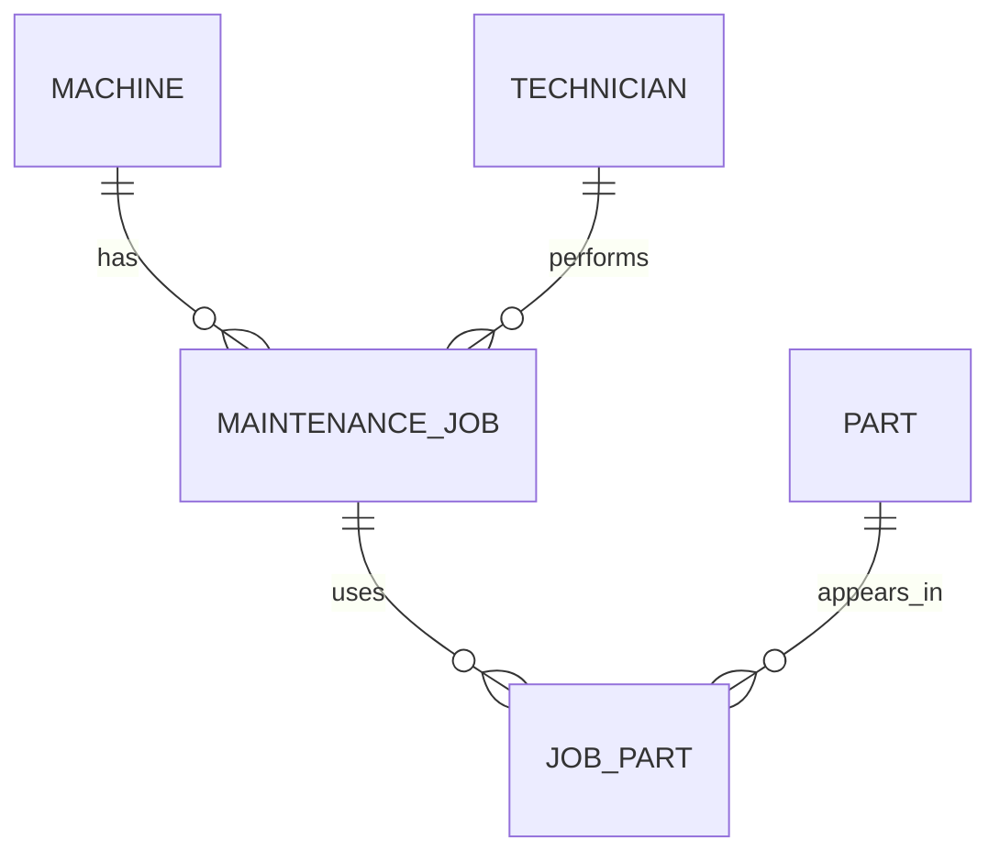

The intended entities are:

Machine - a machine in the plant. It has a name, serial number, site, and installation date.

Part - a spare part used during maintaenance. It has a part number, description, and unit price.

Maintenance job - a maintence event. It records when the work happened, which machine it was for, and which technician did it.

Technician - a person who performs maintence jobs. The sample only stores the technician's name in each job; making a Technician 
             a separate entity is a proposed improvement.

JobPart - a linking entity between jobs and parts. A job may use many parts, and a part may be used in many jobs, so this junction 
          table records each job–part pairing.   

## Reconstructed ER diagram

