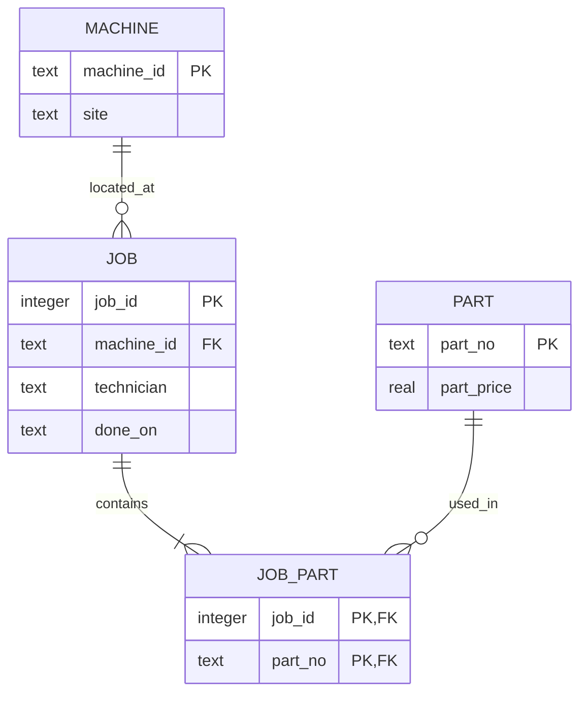

# Module 05 — Normalization notes and evidence

Official sequence: [seven rounds in the course workbook](https://github.com/iotempire/iotempire-teaching/blob/main/full-classes/hsbi-databases-10d/modules/05-normalization-vs-denormalization.md).

## Round 1 — Functional dependencies

Under the module's stated business assumptions:

| Dependency | Basis |
|---|---|
| `job_id → machine_id, technician, done_on` | One machine, responsible technician, and completion date per job |
| `machine_id → site` | One current site per machine |
| `part_no → part_price` | One current catalogue price per part; historical transaction prices would require a different model |
| `(job_id, part_no)` | Candidate key for a job-part line |

The five supplied rows only *happen* to associate some technicians and machines. They do not establish dependencies such as `technician → machine_id` or `machine_id → technician`.

### ER sketches

The conceptual decomposition used by the build is:



## Round 2 — Anomalies

Ran `uv run python Module05/anomalies.py`:

- Update anomaly: moving `cnc-01` in the five-row flat relation changed 3 repeated rows.
- Insert anomaly: the flat relation accepted a part-only row for `P-9999` only by using NULL job fields.
- Delete anomaly: deleting the last `P-0002` job-part row also removed the only stored fact about that part.

The text console did not render the umlaut in “Gütersloh” cleanly, but that display issue did not affect the SQL results.

## Round 3 — Build and normalize

Ran `uv run python Module05/build.py` (Python 3.14.9, SQLite 3.53.1):

```text
row counts: {'flat_jobpart': 200000, 'machine': 50, 'part': 10, 'job': 20000, 'job_part': 200000, 'report_jobpart': 200000}
foreign_key_check: clean
distinct FDs observed: machine_id -> site; job_id -> machine_id, technician, done_on; part_no -> part_price
```

The 3NF join tables reproduce all 200,000 job-part lines. `part` contains 10 rows because the deterministic data generator uses ten distinct part numbers; each part price depends on its part number.

## Round 4 — Compare report queries

Ran the warmed, interleaved benchmark five times per design. Both queries returned the same 350 grouped rows.

```text
normalized median: 121.631 ms
report-table median with ix_report_machine: 197.303 ms
normalized / report-table ratio: 0.62x
report-table median after dropping ix_report_machine: 118.366 ms
```

The normalized plan scans `job_part`, looks up `job`, `machine`, and `part`, and uses a temporary B-tree for grouping. The indexed report plan scans `report_jobpart` using `ix_report_machine` and also uses a temporary B-tree. After dropping that index and reopening the connection, the plan is a table scan plus temporary B-tree. On this run the index made the report slower; this is a small synthetic dataset and one machine-specific result, not a universal rule.

## Round 5 — Write and storage costs

Ran `uv run python Module05/update_cost.py`:

```text
rows updated in normalized machine table: 1
rows updated in denormalized report table: 4000
3NF machine update: 6.618 ms
report table update: 50.103 ms
dbstat bytes by object: job 655360; job_part 3407872; machine 4096; part 4096; report_jobpart 11091968
normalized table objects: 4071424 bytes
report table object: 11091968 bytes
```

These storage totals are the reported table objects; they do not represent a complete production database including every index and operational cost.

## Round 6 — Decision

See [decision-memo.md](decision-memo.md). In this run, the report copy did not improve the measured query. The normalized design also had lower measured table storage and lower update fan-out. A different workload or larger dimensions may change the result.

## AI check

Prompt used in the Codex study session: “List the functional dependencies in the supplied flat job-part relation, distinguish the domain rules from patterns that merely appear in five rows, and identify a candidate key.” The candidate key and domain dependencies are listed above. I rejected sample-only technician/machine associations as domain rules because the module's business model does not make them unique.

## Round 7 — Harvest and pod check

Not yet recorded. Add the actual curiosity, neighbour gate question, and pod response after that discussion; no gate or harvest has been invented.
